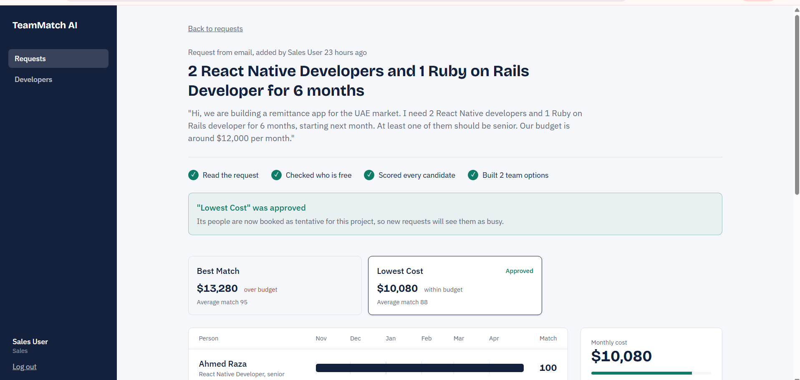
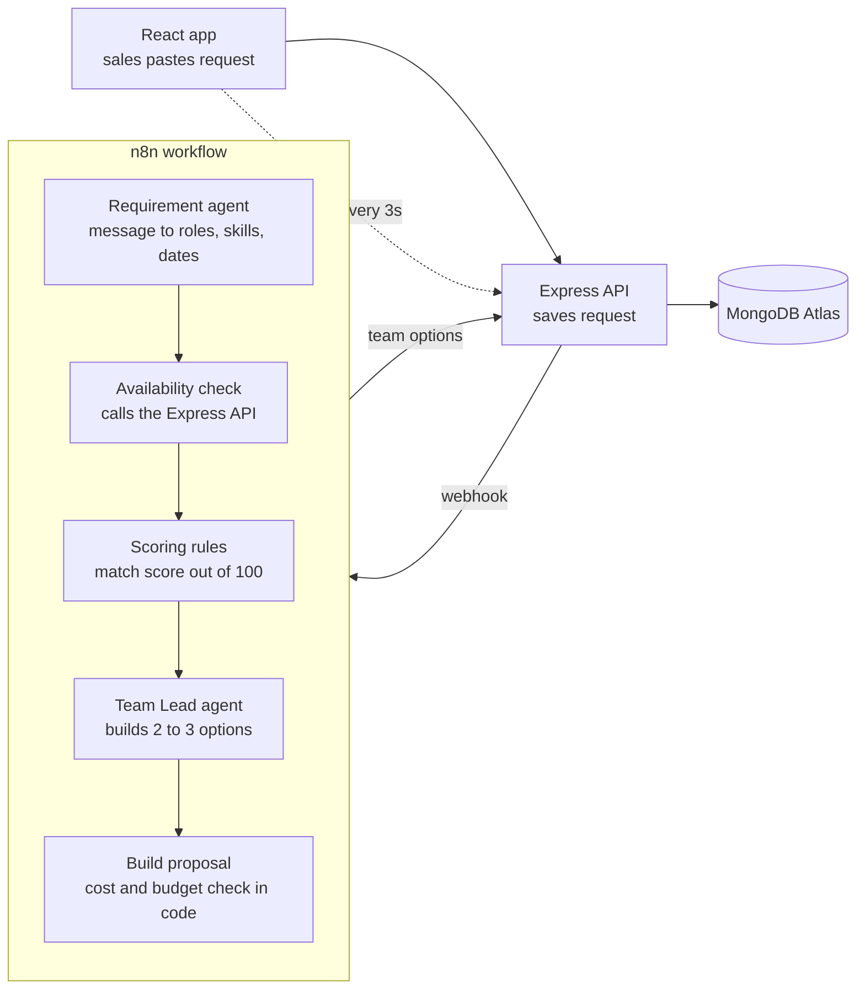
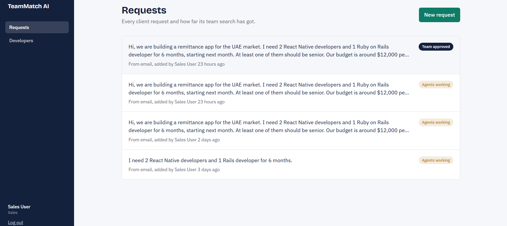
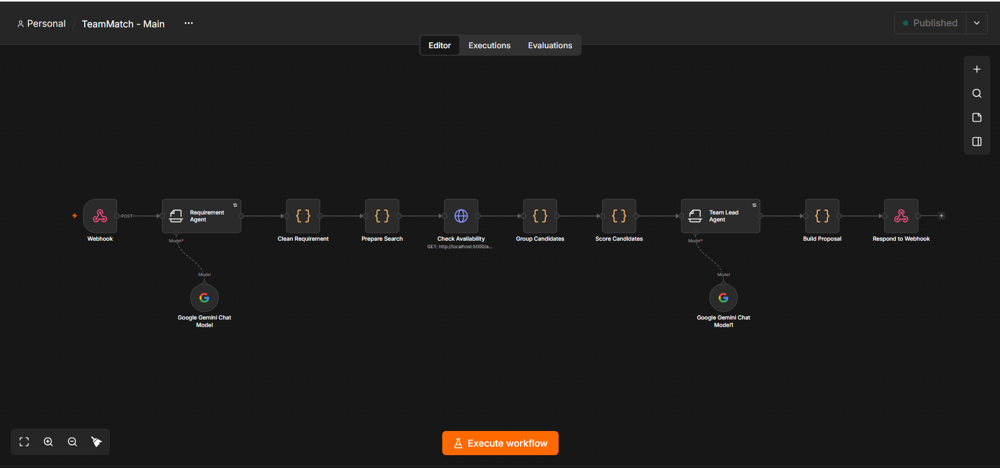

# TeamMatch AI

**Paste a client's team request. Get two or three ready-to-send team options in under a minute.**

TeamMatch AI is a multi-agent system for software houses. A sales person pastes what the client wrote, and AI agents work out the roles, check who is actually free in those dates, score every candidate and build team options with a reason for each pick, the monthly cost and any gaps. One click approves a team and books its people, so nobody sells the same developer twice.



---

## The problem

A client writes: *"I need 2 React Native developers and 1 Rails developer for 6 months, starting next month."*

Today someone in sales asks around: who is free, who has the skill, who is senior enough, will it fit the budget? That takes a day or two. A slow answer can lose the client, and developers who are free but not noticed sit on the bench while the company still pays them.

## How it works



1. **Requirement agent** (Gemini) turns the client's message into structured needs: each role with its skills, seniority and headcount, plus duration, start date, budget, industry and team-wide notes like "at least one senior".
2. **Availability check** asks the Express API who is free between those dates. A developer is free when their allocations in that period add up to less than 100%. No AI here, just arithmetic.
3. **Scoring rules** give every candidate a match score: up to 70 points for availability (minus one point per day of waiting) and up to 30 for seniority fit.
4. **Team Lead agent** (Gemini) picks 2 to 3 genuinely different teams, such as best match and lowest cost, respects the client's notes and writes a client-ready reason for each person.
5. **Build proposal** looks every pick up in our own data, drops anything the AI invented, and calculates cost and budget warnings in code.

## Design decisions

- **The AI decides, the code counts.** Match scores, costs and budget checks are calculated in code. In testing, the Team Lead agent once called a $13,280 team "comfortably within" a $12,000 budget. Numbers you cannot explain do not belong in a sales proposal.
- **Every AI output has a schema.** Both agents fill a JSON schema, so the next step can rely on the shape of the data.
- **No AI where a query will do.** Availability is a date-range overlap check. It is faster, free and always correct.
- **The AI cannot invent people.** Every pick is checked against the real candidate list before it is saved.
- **Check again before booking.** Approving a team re-checks each person's availability, so two sales people cannot book the same developer for overlapping work.
- **Resilient to a busy model.** AI nodes retry three times with a five-second wait, and a failed run marks the request as failed instead of leaving it stuck.
- **Fast for the user.** Express answers at once and runs the agents in the background. The page polls every three seconds until the options are ready.

## Tech stack

| Layer | Tools |
|---|---|
| Frontend | React (Vite), Tailwind CSS v4, React Router, Axios |
| Backend | Node.js, Express 5, Mongoose, JWT, bcryptjs |
| Database | MongoDB Atlas |
| Automation and AI | n8n (self-hosted), Google Gemini, Information Extractor nodes |

## Screenshots

**Requests inbox**



**The n8n workflow**



## Run it locally

You need Node.js 22 or newer, a free MongoDB Atlas cluster, n8n and a Google Gemini API key.

**1. Backend**

```bash
cd server
npm install
cp .env.example .env      # then fill in the values
npm run seed              # 30 demo developers, 12 projects, 45 allocations
npm run dev               # http://localhost:5000
```

**2. Frontend**

```bash
cd client
npm install
cp .env.example .env
npm run dev               # http://localhost:5173
```

**3. n8n**

```bash
npm install -g n8n
n8n                       # http://localhost:5678
```

In n8n, import `n8n/teammatch-main.json`, add a Google Gemini credential and a Header Auth credential named `x-api-key` with the same value as `N8N_API_KEY`, then publish the workflow.

Log in with `sales@teammatch.dev` / `Sales123` and try the example request.

## API

| Method | Route | Purpose |
|---|---|---|
| POST | `/api/auth/login` | Log in, returns a JWT |
| GET, POST, PUT | `/api/developers` | Developer directory, filter by skill, seniority or department |
| GET | `/api/developers/available` | Who is free between two dates. Used by n8n with an API key |
| GET, POST | `/api/projects` | Client projects |
| GET, POST | `/api/allocations` | Who works where and when, with an over-booking check |
| GET, POST | `/api/requests` | Client requests. Creating one starts the agents |
| GET | `/api/requests/:id` | A request with its team options |
| POST | `/api/proposals/:id/approve` | Approve an option and book its people as tentative |

## Roadmap

- RAG over past projects, so a fintech request prefers people who have built fintech apps before
- A daily bench check that suggests open requests for developers who become free soon
- Live progress per agent instead of one status for the whole run
- Slack or WhatsApp alerts when options are ready

---

Built by **Nouman** · [GitHub @CodeWithNouman99](https://github.com/CodeWithNouman99)
